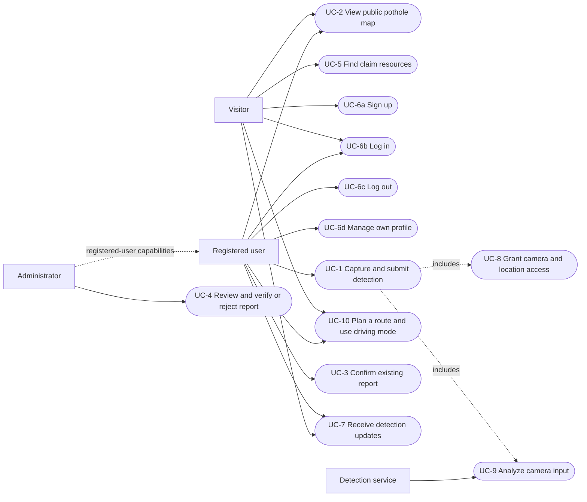
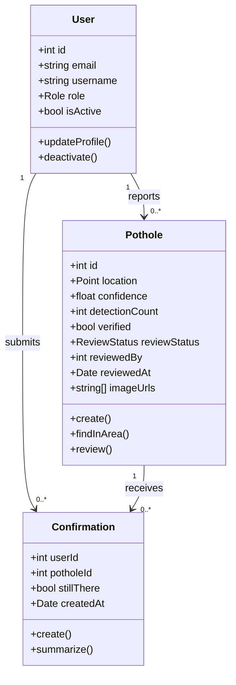
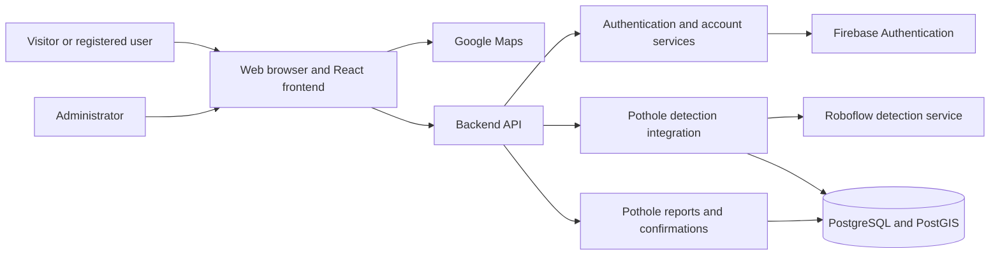
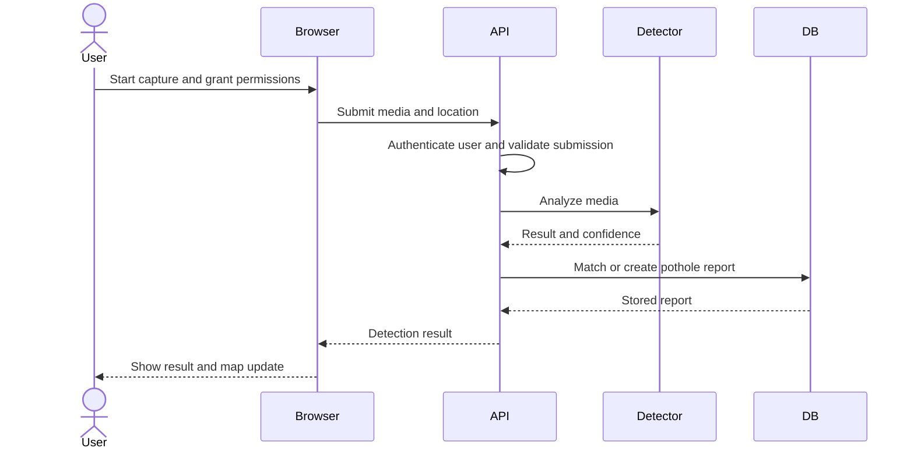
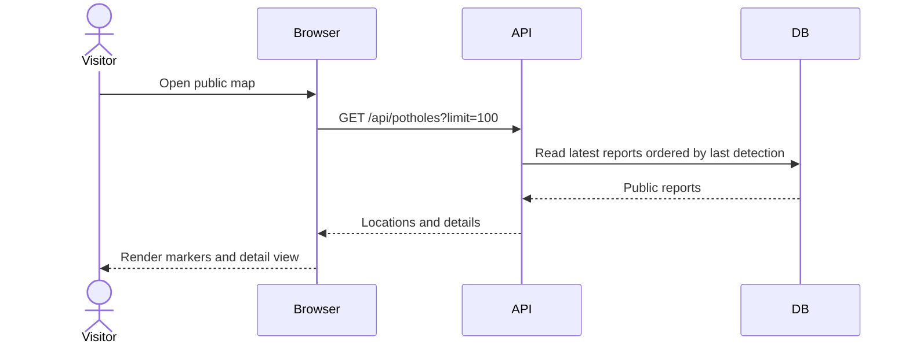
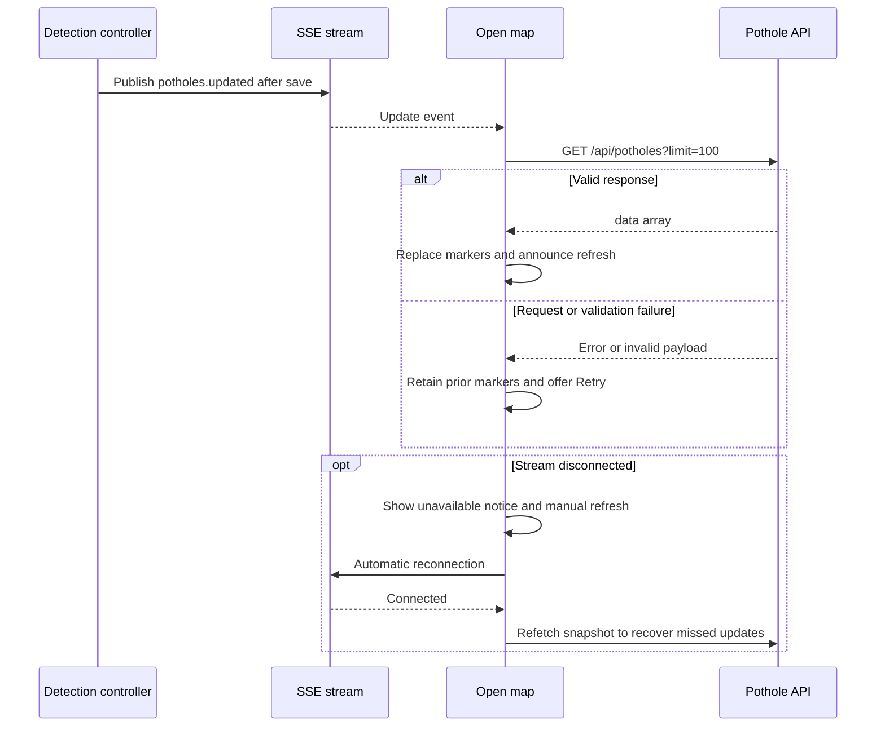
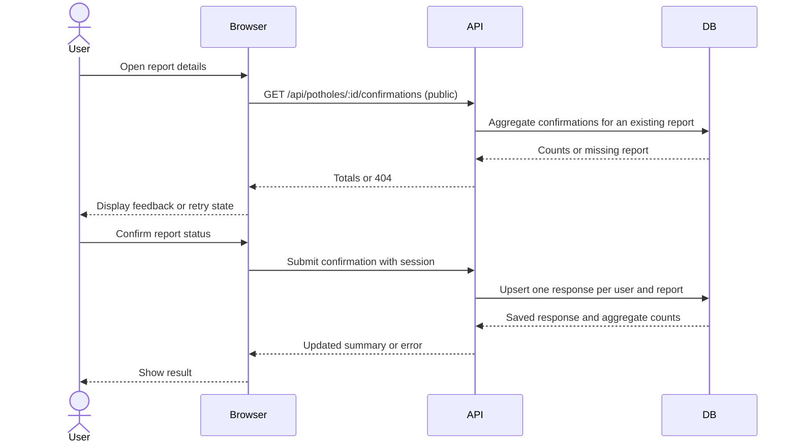
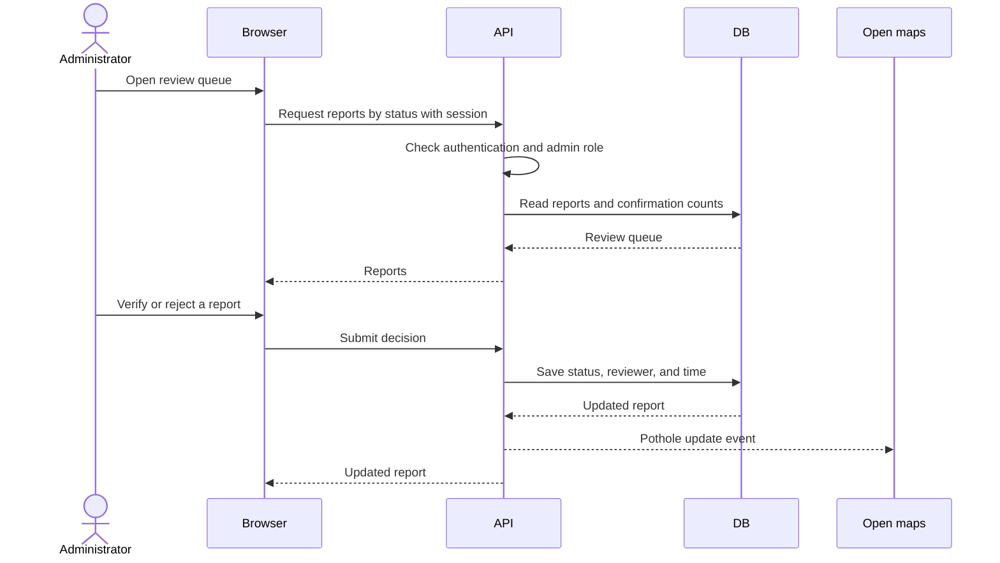

# Software Requirements and Design Report

**Project:** Open Pothole Tracker

**Version:** 2.2
**Authors:** Linh Nguyen, Thien Le, Vinh Do, Hoang Vu, Quang Minh Nguyen

**Status:** Current requirements and design; implementation does not establish verification.

## 1. Overview and scope

Open Pothole Tracker is intended to let people detect potholes from device camera input, associate detections with GPS coordinates, view reports on a shared interactive map, receive timely updates, confirm whether a pothole remains, and let administrators review reports. Visitors should also be able to find pothole claim resources. The target is a mobile-friendly web application.

**Actors:** visitor (no account), registered user, administrator, and the external detection service/model. Administrators also have registered-user capabilities. “Report” below means a stored pothole record; “detection” means a camera-analysis result that may create or update a report.

## 2. Functional requirements

Each requirement describes a user-visible capability at a high level. The lead and supporting modules identify where the work belongs; several flows require integration across team members. Priorities describe proposed scope.

| ID | Priority | Functional requirement | Lead module / member | Supporting module(s) |
| --- | --- | --- | --- | --- |
| FR-01 | High | Users shall be able to create accounts, sign in and out, and manage their profiles. | Authentication and accounts — Hoang Vu | Backend API — Linh Nguyen |
| FR-02 | High | Visitors and users shall be able to explore an interactive map and view pothole details by location. | Frontend and map — Thien Le | Geospatial — Vinh Do; backend API — Linh Nguyen |
| FR-04 | High | Users shall be able to capture road footage with their device camera and share their location for detection. | Camera, GPS, and geospatial — Vinh Do | Frontend — Thien Le |
| FR-05 | High | The system shall analyze submitted camera data for potholes and return detection results. | AI detection — Quang Minh Nguyen | Camera/GPS — Vinh Do; backend API — Linh Nguyen |
| FR-06 | High | The system shall store and retrieve pothole reports with their location, detection information, and images. | Backend, database, and APIs — Linh Nguyen | AI detection — Quang Minh Nguyen; geospatial — Vinh Do |
| FR-09 | High | Users shall be able to confirm whether a pothole is still present and view community feedback. | Crowdsourcing — Linh Nguyen | Frontend — Thien Le |
| FR-10 | High | Administrators shall be able to review reports, images, and confirmations in a dashboard and verify, reject, or manage reports. | Administration — Hoang Vu | Backend/API — Linh Nguyen; frontend — Thien Le |
| FR-11 | High | The system shall restrict account, confirmation, and administrative actions according to user identity and role. | Authentication and authorization — Hoang Vu | Backend API — Linh Nguyen |
| FR-07 | Medium | The system shall support nearby-pothole lookup and handling of duplicate reports. | Geospatial — Vinh Do | Backend/database — Linh Nguyen |
| FR-08 | Medium | Users shall receive real-time detection notifications and see newly reported potholes on the map. | Real-time backend — Linh Nguyen | Frontend and map — Thien Le |
| FR-03 | Low | Visitors shall be able to find insurance and transportation-agency resources for pothole claims. | Public frontend — Thien Le | — |
| FR-12 | Medium | Visitors and users shall be able to search for a starting point and destination, select a driving route, start or stop map following, and receive nearby-pothole warnings when location is available. | Frontend and map — Thien Le | GPS/geospatial — Vinh Do; backend API — Linh Nguyen; Google Maps |

Detection creation currently uses a 10-meter matching radius. Detection thresholds and validation of this duplicate policy still need team agreement. The report-review policy is described in UC-4.

## 3. Non-functional requirements

These are proposed, testable acceptance criteria. Numeric targets are drafts pending team agreement.

| ID | Property | Proposed criterion and verification |
| --- | --- | --- |
| NFR-01 | Security | Serve production traffic over HTTPS; use HttpOnly, Secure session cookies; protect account changes, confirmation writes, and administrative actions with appropriate authentication and ownership/admin checks. Public map and aggregate confirmation reads do not require sign-in. Detection writes require a signed-in user; image attachment also checks owner or administrator access. Verify protected actions with unauthorized and cross-user requests. |
| NFR-02 | Privacy | Request camera access for detection and location access for detection or a location-centered map; explain each purpose and avoid storing raw footage unless the user submits it. Verify permission, denial, and stored-payload behavior. |
| NFR-03 | Data integrity | Reject coordinates outside latitude −90..90 and longitude −180..180, confidence outside 0..1, and additional confirmation rows for the same user/report. Repeated confirmation submissions shall update the existing response. Verify API validation and the unique user/report constraint. |
| NFR-04 | Performance | Proposed target: 95% of map-area requests complete within 2 seconds for an agreed test data set and deployment environment. Measure at the API boundary. |
| NFR-05 | Update latency | Proposed target: an accepted report appears on an open map within 10 seconds under a working network connection. Measure end-to-end. |
| NFR-06 | Reliability | A detection-service failure must not create a confirmed pothole or crash the API; users receive a recoverable error. Verify fault injection. |
| NFR-07 | Accessibility | Core account, map, and reporting tasks shall be usable by keyboard and expose text alternatives/status to assistive technology. Verify manual keyboard and screen-reader checks. |
| NFR-08 | Compatibility | Support current desktop and mobile browsers that provide required camera/geolocation APIs; provide a clear fallback when a browser or device lacks them. Verify a documented browser/device matrix. |
| NFR-09 | Visual consistency | Preserve the agreed page layout, typography, colors, marker animations, popup/image presentation, and responsive behavior throughout the application. Compare rendered screens using the same viewport, theme, map configuration, location, and data. |

## 4. Use cases

Each labeled use case in this diagram has a textual description below. These describe the intended behavior; implementation gaps are stated explicitly. UC-6 is split into account subcases so registration, login, logout, and profile editing each have their own flow.



**UC-1 Capture and submit detection**

- **Actors and requirements:** Registered user; browser camera/location services; detection service. FR-04, FR-05, FR-06, FR-07, FR-08; NFR-02, NFR-03, NFR-06.
- **Trigger and preconditions:** The user selects Capture on the map. Camera and location APIs must be available in a secure browser context. Sign-in is required for detection writes in the current system. Signed-out map visitors receive a sign-in link; an expired session during submission produces a sign-in message.
- **Main flow:** (1) Explain camera/location use and let the user select Start camera through UC-8. (2) Display the camera preview. (3) Capture a JPEG and obtain coordinates, accuracy, and capture time. (4) Show the preview for review. (5) The user selects Analyze. (6) Execute UC-9. (7) Match a qualifying detection within 10 meters or create a report, attach its image, and publish an update. (8) Show the outcome and refresh the map.
- **Alternatives and errors:** Permission denial keeps the dialog usable and explains the problem. Closing the camera ignores a late GPS result and stops its stream. The user can discard a capture; a discarded or replaced submission cannot update the new preview. No qualifying detection displays a distinct outcome. Invalid media, service failure, or network failure displays an error and allows retry. Aborting a browser request does not undo any backend write already completed; retries are not guaranteed to be idempotent.
- **Postconditions and status:** A successful qualifying submission stores a report/detection and photo; no qualifying prediction creates no report. Camera and submission UI are implemented and tested with browser substitutes; live Roboflow/PostGIS verification remains pending.

**UC-2 View public pothole map**

- **Actors and requirements:** Visitor or registered user. FR-02, FR-06; NFR-07, NFR-08, NFR-09.
- **Trigger and preconditions:** Open `/map`. No account is required. Google Maps configuration and public API access are needed for the complete map.
- **Main flow:** (1) Obtain location or use the fallback center. (2) Request `GET /api/potholes?limit=100`. (3) Validate the response and normalize IDs. (4) Render the latest reports as markers. (5) Select a marker to view coordinates, date, confidence, count, verification state, and photos. (6) Read public aggregate feedback through `GET /api/potholes/:id/confirmations`; display nonzero totals when available. (7) Open and navigate photos, then close the viewer or details.
- **Alternatives and errors:** Missing map configuration shows an unavailable message. Location denial uses the fallback. An empty response is announced separately from a failed or malformed response. Errors provide Retry and retain any previously loaded markers. Missing photos use an unavailable-image placeholder. Keyboard users can activate markers, cycle dialog controls, close with Escape, and return focus to the trigger.
- **Postconditions and status:** Public information is displayed without a write. The current list is the latest 100 reports globally, not a viewport-bounds search. Populated, empty, invalid, failed, and recovery UI paths are tested with substituted Maps/API responses; a subsequent real Google Maps/PostGIS check also verified marker selection, stored photo display, and mobile details using synthetic records.

**UC-3 Confirm existing report**

- **Actors and requirements:** Registered user. FR-09, FR-11; NFR-01, NFR-03.
- **Trigger and preconditions:** Open an existing report and select Still There or Not There. An active authenticated session is required to submit a confirmation; reading aggregate totals is public.
- **Main flow:** (1) Choose the report status. (2) Disable the controls while saving. (3) Submit the report ID and `stillThere` value. (4) Upsert one response for the user/report pair. (5) Display returned still-there and not-there totals.
- **Alternatives and errors:** Visitors receive a sign-in link. Expired sessions, missing reports, validation failures, and network failures do not display a success result and allow recovery. A repeat submission updates the existing response instead of adding a second vote.
- **Postconditions and status:** One current response exists per user/report after success. The summary endpoint returns `still_there`, `not_there`, and `my_response` (null for a visitor or no prior vote). Existing visible reports without votes return zero counts; missing or rejected reports return 404. The popup retains the signed-in user's earlier answer. Opening or reopening details requests these totals; failed reads offer retry and do not appear as zero votes. A pending read is cancelled before a vote so it cannot overwrite the returned totals. Confirmation writes do not currently publish SSE updates. Integrated verification of the current interface remains pending.

**UC-4 Review and verify or reject report**

- **Actors and requirements:** Administrator. FR-10, FR-11; NFR-01, NFR-03.
- **Trigger and preconditions:** An authenticated administrator opens the review dashboard. Required database migrations are applied.
- **Main flow:** (1) Filter the queue by pending, verified, or rejected. (2) Inspect location, photos, detections, and community feedback. (3) Verify or reject the report. (4) Enforce administrator access and save status, reviewer, and review time. (5) Publish a pothole update and refresh the queue/map.
- **Alternatives and errors:** Unauthenticated and non-admin callers are denied. Invalid decisions and missing reports return errors. Rejected reports are hidden from public list, detail, nearby, and along-route reads. A new nearby detection reopens a rejected report as pending and clears its prior review.
- **Postconditions and status:** The latest decision is stored; a full decision history is not retained. Administrative review is implemented; verification of the integrated system remains pending.

**UC-5 Find claim resources**

- **Actors and requirements:** Visitor or registered user. FR-03; NFR-07, NFR-08.
- **Trigger and preconditions:** Open `/`; no login is required.
- **Main flow:** (1) View the agency/insurer resource cards. (2) Select a resource. (3) Open the provider's website or form in a new tab. (4) Consult that provider's instructions.
- **Alternatives and errors:** An unavailable external website or provider login is handled by that website; the application's resource page remains available. The user may return and select another resource.
- **Postconditions and status:** No claim is submitted or reimbursement guaranteed by this application. External resource content and eligibility are controlled by the respective providers.

**UC-6a Sign up**

- **Actors and requirements:** Visitor. FR-01; NFR-01, NFR-03.
- **Trigger and preconditions:** Open `/signup` without an existing session and provide registration details.
- **Main flow:** (1) Enter username, email, and password. (2) Submit. (3) Validate fields and email uniqueness. (4) Hash the password and create the account. (5) Present the registration result and continue to account access.
- **Alternatives and errors:** Invalid fields, an existing email, and a service failure show an error; the user corrects inputs or retries. Do not report account creation until the API confirms it.
- **Postconditions and status:** A valid registration creates an account. Account UI/API exist; full registration and session behavior need live verification by the authentication owner.

**UC-6b Log in**

- **Actors and requirements:** Visitor or registered user; Firebase for Google sign-in. FR-01, FR-11; NFR-01.
- **Trigger and preconditions:** Open `/login`; an email/password account or configured Google sign-in is available.
- **Main flow:** (1) Submit credentials or complete the Google popup. (2) Verify credentials/token and account status. (3) Issue the session cookie. (4) Load the user's identity and expose authenticated actions.
- **Alternatives and errors:** Invalid credentials, inactive accounts, cancelled popups, missing provider configuration, or network errors leave the user signed out and show an appropriate failure.
- **Postconditions and status:** A successful login establishes a session; failure does not grant access. Implementation exists; live account/provider verification remains pending. Authentication errors use the shared API error helper.

**UC-6c Log out**

- **Actors and requirements:** Signed-in user. FR-01; NFR-01.
- **Trigger and preconditions:** Select logout with an active session.
- **Main flow:** (1) Request logout. (2) Clear the session cookie on the server response. (3) Clear frontend user state. (4) Return to public access.
- **Alternatives and errors:** If the request fails, avoid claiming the server session has been cleared; allow recovery. An already-expired session must not trigger recursive logout requests.
- **Postconditions and status:** After success, protected actions require authentication again. The implementation exists; cookie/session behavior requires live verification.

**UC-6d Manage own profile**

- **Actors and requirements:** Registered user. FR-01, FR-11; NFR-01, NFR-03.
- **Trigger and preconditions:** Open `/profile` with an active session.
- **Main flow:** (1) Load the user's profile. (2) Edit supported account fields or request a password change. (3) Validate ownership, values, and current password when applicable. (4) Save and show the result.
- **Alternatives and errors:** Duplicate email, invalid fields, incorrect password, expired session, or failed requests show errors. Google-only accounts cannot change a local password through this endpoint. Avatar upload is not implemented despite the existing button.
- **Postconditions and status:** Successful edits affect only authorized account data. Profile routes exist; live validation and ownership checks remain pending. Stored detection counts are displayed.

**UC-7 Receive detection updates**

- **Actors and requirements:** Visitor or registered user viewing the map. FR-08; NFR-05, NFR-06, NFR-07.
- **Trigger and preconditions:** The map subscribes to `/api/events`; the backend publishes `potholes.updated` after a detection write.
- **Main flow:** (1) Receive and validate the event type. (2) Fetch the latest pothole list. (3) Replace displayed records after validation. (4) Announce that the map refreshed only after the fetch succeeds.
- **Alternatives and errors:** Ignore malformed or unrelated events. When the stream fails, show an unavailable notice and manual Refresh map control; EventSource retries automatically. On reconnection, refetch because missed events are not replayed. A failed list refresh shows Retry and does not announce success.
- **Postconditions and status:** The map reflects the successfully fetched snapshot. Reconnection, delayed refresh, and failure/recovery are browser-tested with substituted events/API responses. A subsequent real Maps/PostGIS check delivered new markers to two browser tabs. Measured latency, deployment buffering, and live inference remain unverified. Current SSE delivery is in-process and has no cross-server distribution or replay.

**UC-8 Grant camera and location access**

- **Actors and requirements:** User and browser permission services. Included by UC-1. FR-04; NFR-02, NFR-08.
- **Trigger and preconditions:** Open the capture dialog while signed in; the browser supports camera and location in its current security context.
- **Main flow:** (1) Explain camera/location purposes, then request camera access after Start camera and display the preview after approval. (2) On capture, request a fresh position. (3) Associate the image with coordinates, accuracy, and capture time.
- **Alternatives and errors:** Unsupported camera APIs, denied permissions, camera startup failure, location timeout, or unavailable location show a recoverable explanation. Closing the dialog stops camera tracks and ignores unfinished capture work. Map browsing can still use fallback location without capture permissions.
- **Postconditions and status:** A capture is ready only after both image and location are available. Permission failures and late location responses are browser-tested with substitutes; actual mobile camera/GPS accuracy remains pending.

**UC-9 Analyze camera input**

- **Actors and requirements:** Detection service, called by the application's backend for UC-1. FR-05; NFR-03, NFR-06.
- **Trigger and preconditions:** Receive a nonempty supported JPEG/PNG, bounded coordinates, timestamp, and optional accuracy; Roboflow configuration is available.
- **Main flow:** (1) Validate input. (2) Preprocess the image and call Roboflow. (3) Validate predictions. (4) Select the highest-confidence pothole prediction meeting the current 0.6 threshold. (5) Return the outcome to UC-1 for persistence or a no-detection result.
- **Alternatives and errors:** Missing configuration returns 503; inference failure returns 502; invalid inputs are rejected. A valid result without a qualifying prediction returns `detected: false` and does not create a report. Confidence and duplicate policies still require team evaluation.
- **Postconditions and status:** Analysis provides an accepted candidate, no candidate, or a distinguishable error. Mocked backend tests cover qualifying/nonqualifying results and invalid coordinates. Live model accuracy, lighting/road variation, and credentials are owned by the detection team and remain pending.

**UC-10 Plan a route and use driving mode**

- **Actors and requirements:** Visitor or registered user; Google Maps address, geocoding, and directions services; browser location/heading services. FR-02, FR-07, FR-12; NFR-02, NFR-06, NFR-07, NFR-08, NFR-09.
- **Trigger and preconditions:** Select Directions on the map. Address search and routing require enabled Google services and a working connection. Live map following and nearby warnings require an actual device location; the fallback map center is not treated as a device position.
- **Main flow:** (1) Open the From/To drawer. (2) Select a starting address or current location and a destination. (3) Request driving-route alternatives and display route summaries, distances, and durations. (4) Select a route. (5) Start Driving once a route is available. (6) Follow location updates at zoom 17 with a tilted map. (7) Query the nearby-pothole API within 200 meters, using travel or compass heading when available to filter warnings ahead. (8) Display a warning for the closest qualifying report. (9) Stop driving to end warning polling and restore the map's normal tilt.
- **Alternatives and errors:** Failed address or route requests show an explanation; directions can be retried. Editing an address clears the previous routes and stops driving. A failed nearby lookup shows an unavailable notice and retries automatically. Missing location pauses following/warnings and explains the limitation. A user can dismiss a warning. No detection-provider request is needed for this workflow.
- **Postconditions and status:** Route selection is held in browser state and does not create a pothole record. Nearby queries use a radius of 200 meters and a limit of 100; the next query is scheduled three seconds after completion of the previous one. A warning is visible for up to six seconds, with a nine-second interval between repeated warnings for the same report. These are implementation settings, not measured safety or latency guarantees. Implementation is present; functional, visual, and physical-device verification remains pending.

## 5. Design and interaction diagrams

The repository uses TypeScript modules and object-style models rather than a complete class hierarchy. This conceptual domain diagram shows data and intended operations. `deactivate`, `create`, and `summarize` correspond to existing model methods, and `review` corresponds to `PotholeReviewModel.recordDecision`; `updateProfile` and `findInArea` are conceptual names for the existing profile update and map queries.



The domain diagram above shows the core data classes. This component overview shows how the rest of the system fits together; these components are not additional domain classes.



### Sequence diagram — detect and report



**Camera/GPS interaction (FR-04):** The map's capture control opens a modal that explains the camera and location purposes before the user starts the camera. The browser requests video access only after **Start camera** is selected. On **Capture**, it creates one JPEG frame (scaled to at most 1600 pixels on its longest side and checked against the API's 5 MB limit), requests a fresh high-accuracy location reading, validates the returned coordinates and accuracy, and keeps the image, location, capture time, and reported GPS accuracy in the browser preview. The user can discard the preview or select **Analyze** to send the image and location to `POST /api/detections/report`. Closing the modal stops its video tracks; permission denial, unavailable camera/location, and location timeout have visible error states. The map's separate location-centering request can occur when the map opens, before the capture modal is used.

The frame and GPS reading are collected in sequence, so movement or poor GPS accuracy can make the stored location differ from where the image was taken. A maximum acceptable GPS error and a policy for whether such captures should be submitted have not been agreed. The camera and location workflow requires browser support and a secure context on deployed devices; device-specific behavior remains to be verified.

### Sequence diagram — view map



**Sequence diagram — live map updates and recovery**



**Sequence diagram — route and nearby warnings**

```mermaid
sequenceDiagram
  actor User
  participant Browser
  participant Maps as Google Maps services
  participant GPS as Device location
  participant API as Nearby pothole API
  User->>Browser: Choose origin and destination
  Browser->>Maps: Search/geocode addresses and request routes
  Maps-->>Browser: Route alternatives or error
  User->>Browser: Select route and start driving
  GPS-->>Browser: Location and available travel heading
  loop While driving, with location available
    Browser->>API: GET nearby (radiusMeters=200, limit=100)
    API-->>Browser: Nearby reports or error
    Browser->>Browser: Filter by distance/heading; warn or show unavailable status
  end
  User->>Browser: Stop driving
  Browser->>Browser: Cancel polling, dismiss warning, restore map tilt
```

### Sequence diagram — confirm report



### Sequence diagram: review report



### Frontend component overview

| Component | Responsibility |
| --- | --- |
| `App.tsx`, `appLayout.tsx`, `navbar.tsx` | Define routes and the shared navigation/provider layout. |
| `context/theme.tsx` and shared UI/styles | Apply light/dark themes and consistent desktop/mobile presentation. |
| `homePage.tsx` | Display public transportation-agency and insurer resource cards. |
| `mapPage.tsx`, `authHook.ts`, `compassMarker.tsx` | Request browser location/orientation, render Google Maps and the location arrow, and manage pothole requests and status. |
| `services/potholeService.ts` | Fetch and validate recent/nearby reports and viewer-aware confirmation summaries; submit authenticated detections and votes. |
| `potholeMarker.tsx`, `imageViewer.tsx` | Display markers, report details, community confirmation counts, the user's earlier answer, image thumbnails, and full-screen photo viewing. |
| `adminPage.tsx`, `services/adminService.ts` | Provide the administrator review queue, report evidence, and verify/reject actions. |
| `mapNavigation.tsx`, `locationDrawer.tsx`, `direction.tsx` | Search/select addresses, render route alternatives, manage driving mode and nearby warning queries, and handle service failures. |
| `potholeToast.tsx`, `geoUtils.ts` | Display nearby warnings and calculate distance/bearing for warning candidates. |
| `use-dialog-focus.ts` | Manage focus trapping, Escape dismissal, and focus restoration for report and photo dialogs. |

## 6. Operating environment

- **Hardware platform:** The backend is intended to run on a general-purpose server or development machine; no minimum CPU, memory, or storage requirements have been established. Users will access the system from desktop or mobile devices. Detection requires a camera and location capability.
- **Operating systems:** The deployment operating system and supported client operating-system versions have not yet been selected. The database setup uses Docker Compose, so its host must support Docker.
- **Backend software:** The API uses Node.js 24 or later with Express 5 and TypeScript. It reads `PORT`, `DATABASE_URL`, and `JWT_SECRET` from environment variables.
- **Database software:** Docker Compose runs PostgreSQL 17 with PostGIS 3.5. On a fresh database, it loads the schema from `backend/db/schema.sql`.
- **Client software:** The intended client is a modern desktop or mobile web browser. Specific supported browsers and versions still need to be decided. The React 19/TypeScript frontend includes Vite 7 and Tailwind CSS 4. Google Maps requires `VITE_GOOGLE_MAPS_API_KEY` and `VITE_GOOGLE_MAPS_ID`. With `VITE_API_URL` blank, the development proxy forwards `/api` to `http://localhost:8000`; deployment requires equivalent routing or a configured API origin.
- **Other components:** Google login depends on Firebase Authentication and Firebase Admin, including valid project/service-account configuration. The backend also requires access to the PostgreSQL database. These components must be available and correctly configured for the corresponding features to work.

## 7. Assumptions and dependencies

- Camera and geolocation permissions, GPS accuracy, network connectivity, and browser support affect detection quality and availability.
- Google Maps is the frontend map provider. The backend image-analysis adapter uses Roboflow and requires `ROBOFLOW_API_KEY`, `ROBOFLOW_PROJECT_ID`, and `ROBOFLOW_MODEL_VERSION`.
- Firebase is required only for the Google login path; email/password login uses the local database.
- The database architecture uses PostgreSQL/PostGIS. The database must load the SQL schema before the application can use it; the mounted initialization script will not automatically migrate an existing database volume. Apply the team's reversible scripts in `backend/db/migrations/` in numeric order to existing databases.
- The initial duplicate-detection radius is 10 meters. This assumes detections within that distance may refer to the same pothole; GPS accuracy and road layout may affect whether this threshold is appropriate.

- Detection writes require sign-in in current main. Confirmation reads remain public and optionally identify the viewer; confirmation writes require a session. Owner/admin checks protect image attachment.
- The confirmation-summary read contract is implemented, including the viewer response. Final integrated UI verification is deferred; confirmation writes do not broadcast updated totals to other open detail views.
- Address search, geocoding, and directions depend on Google service availability and project configuration. Route guidance and warnings depend on GPS accuracy and available reports; the application cannot guarantee that every road hazard is recorded or warned about.
- Live inference testing depends on valid Roboflow configuration and evaluation of the model thresholds. Credentials must remain outside version control.
- NFR numeric targets, supported device versions, and exact visual comparisons remain to be confirmed; browser test viewports are not evidence of real-device performance or pixel parity.
