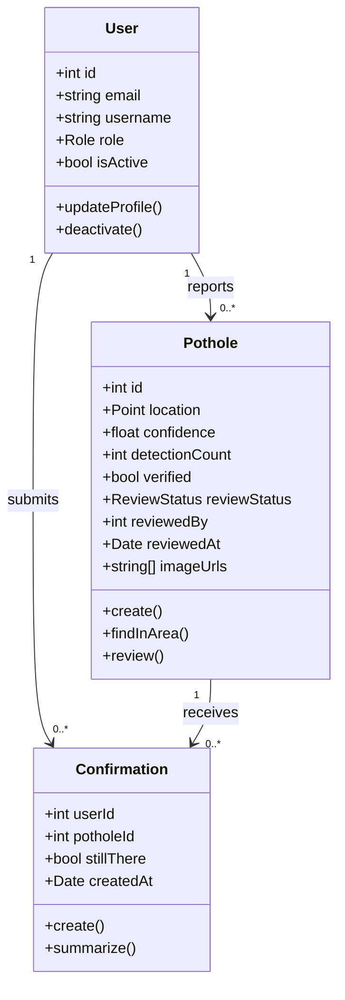
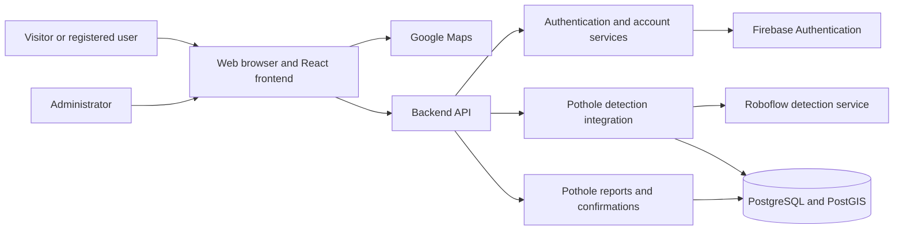
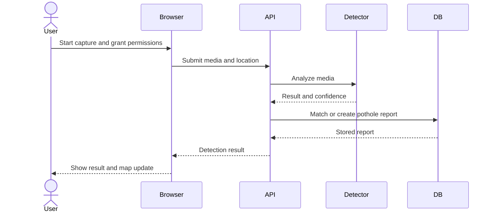
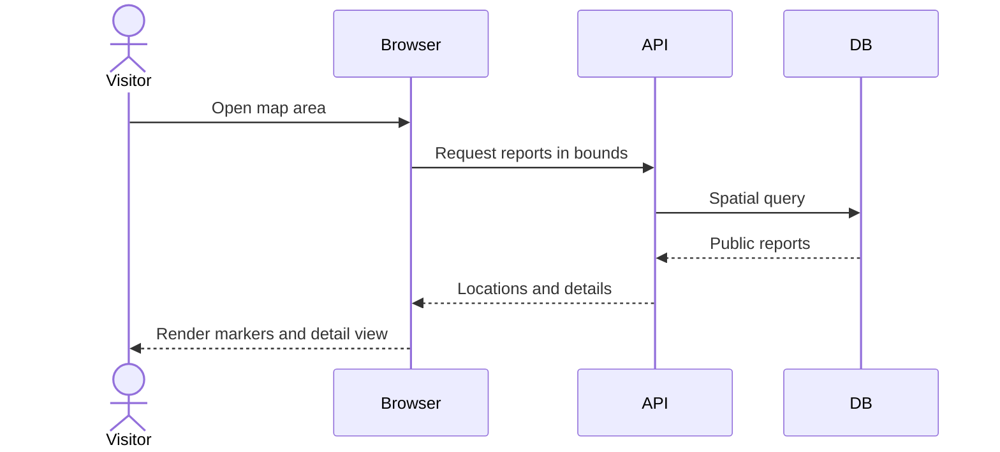
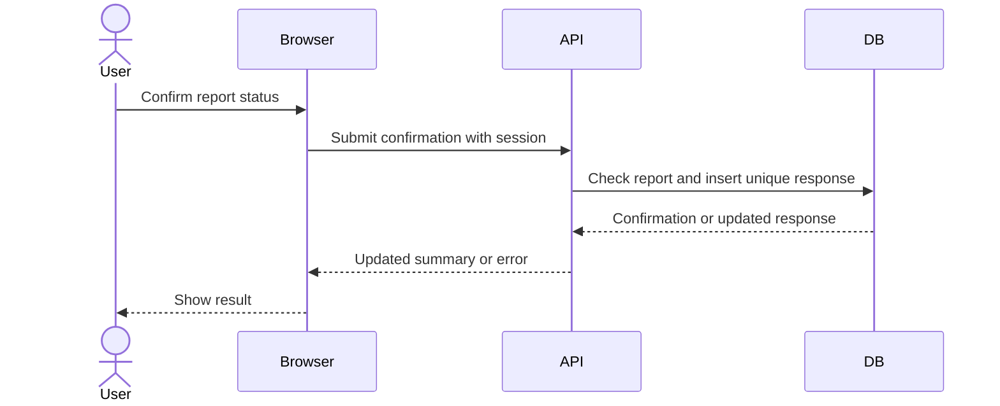
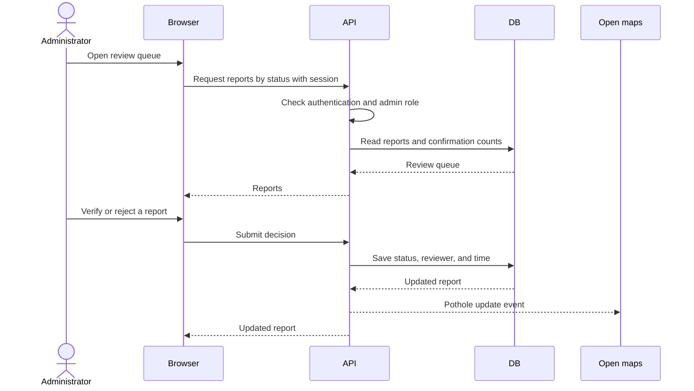

# Software Requirements and Design Report

**Project:** Open Pothole Tracker

**Version:** 2.0
**Authors:** Linh Nguyen, Thien Le, Vinh Do, Hoang Vu, Quang Minh Nguyen

## 1. Overview and scope

Open Pothole Tracker is intended to let people detect potholes from device camera input, associate detections with GPS coordinates, view reports on a shared interactive map, receive timely updates, confirm whether a pothole remains, and let administrators review reports. Visitors should also be able to find pothole claim resources. The target is a mobile-friendly web application.

**Actors:** visitor (no account), registered user, administrator, and the external detection service/model. Administrators also have registered-user capabilities. “Report” below means a stored pothole record; “detection” means a camera-analysis result that may create or update a report.

## 2. Functional requirements

Each requirement describes a user-visible capability at a high level. The lead and supporting modules identify where the work belongs; several flows require integration across team members. Priorities describe proposed scope.

| ID | Priority | Functional requirement | Lead module / member | Supporting module(s) |
| --- | --- | --- | --- | --- |
| FR-01 | High | Users shall be able to create accounts, sign in and out, and manage their profiles. | Authentication and accounts — Hoang Vu | Backend API — Linh Nguyen |
| FR-02 | High | Visitors and users shall be able to explore an interactive map and view pothole details by location. | Frontend and map — Thien Le | Geospatial — Vinh Do; backend API — Linh Nguyen |
| FR-04 | High | Users shall be able to capture road footage with their device camera and share their location for detection. | Camera, GPS, and geospatial — Vinh Do | Frontend — Thien Le |
| FR-05 | High | The system shall analyze submitted camera data for potholes and return detection results. | AI detection — Quang Minh Nguyen | Camera/GPS — Vinh Do; backend API — Linh Nguyen |
| FR-06 | High | The system shall store and retrieve pothole reports with their location, detection information, and images. | Backend, database, and APIs — Linh Nguyen | AI detection — Quang Minh Nguyen; geospatial — Vinh Do |
| FR-09 | High | Users shall be able to confirm whether a pothole is still present and view community feedback. | Crowdsourcing — Linh Nguyen | Frontend — Thien Le; community feedback display (Hoang Vu) |
| FR-10 | High | Administrators shall be able to review reports, images, and confirmations in a dashboard and verify, reject, or manage reports. | Administration — Hoang Vu | Backend/API — Linh Nguyen; frontend — Thien Le |
| FR-11 | High | The system shall restrict account, confirmation, and administrative actions according to user identity and role. | Authentication and authorization — Hoang Vu | Backend API — Linh Nguyen |
| FR-07 | Medium | The system shall support nearby-pothole lookup and handling of duplicate reports. | Geospatial — Vinh Do | Backend/database — Linh Nguyen |
| FR-08 | Medium | Users shall receive real-time detection notifications and see newly reported potholes on the map. | Real-time backend — Linh Nguyen | Frontend and map — Thien Le |
| FR-03 | Low | Visitors shall be able to find insurance and transportation-agency resources for pothole claims. | Public frontend — Thien Le | — |

Detection creation currently uses a 10-meter matching radius. Detection thresholds and validation of this duplicate policy still need team agreement. The report-review policy is described in UC-4.

## 3. Non-functional requirements

These are proposed, testable acceptance criteria. Numeric targets are drafts pending team agreement.

| ID | Property | Proposed criterion and verification |
| --- | --- | --- |
| NFR-01 | Security | Serve production traffic over HTTPS; use HttpOnly, Secure session cookies; protect account, report, confirmation, and review writes with the appropriate authentication and ownership/admin checks. Verify with unauthorized and cross-user requests. |
| NFR-02 | Privacy | Request camera access for detection and location access for detection or a location-centered map; explain each purpose and avoid storing raw footage unless the user submits it. Verify permission, denial, and stored-payload behavior. |
| NFR-03 | Data integrity | Reject coordinates outside latitude −90..90 and longitude −180..180, confidence outside 0..1, and duplicate confirmations. Verify API validation and database constraints. |
| NFR-04 | Performance | Proposed target: 95% of map-area requests complete within 2 seconds for an agreed test data set and deployment environment. Measure at the API boundary. |
| NFR-05 | Update latency | Proposed target: an accepted report appears on an open map within 10 seconds under a working network connection. Measure end-to-end. |
| NFR-06 | Reliability | A detection-service failure must not create a confirmed pothole or crash the API; users receive a recoverable error. Verify fault injection. |
| NFR-07 | Accessibility | Core account, map, and reporting tasks shall be usable by keyboard and expose text alternatives/status to assistive technology. Verify manual keyboard and screen-reader checks. |
| NFR-08 | Compatibility | Support current desktop and mobile browsers that provide required camera/geolocation APIs; provide a clear fallback when a browser or device lacks them. Verify a documented browser/device matrix. |
| NFR-09 | Visual consistency | Preserve the agreed page layout, typography, colors, marker animations, popup/image presentation, and responsive behavior across increments. Compare rendered screens using the same viewport, theme, map configuration, location, and data. |

## 4. Use cases

```mermaid
flowchart LR
  Visitor[Visitor] --> View[View public pothole map]
  Visitor --> Claims[Find pothole claim resources]
  Visitor --> SignUp[Sign up]
  User[Registered user] --> Login[Log in / log out]
  User --> Profile[Manage own profile]
  User --> View
  User --> Detect[Capture and submit detection]
  User --> Confirm[Confirm existing report]
  User --> Alerts[Receive detection updates]
  Detect --> Permission[Grant camera and location access]
  Detect --> Analyze[Analyze camera input]
  Model[Detection service] --> Analyze
  Admin[Administrator (also a registered user)] --> Review[Review and verify/reject report]
```

**UC-1, detect and report:** A signed-in user starts detection, grants camera and location access, captures input, and submits it. The service validates the input and coordinates, analyzes it, and returns a result. An accepted pothole is stored or matched to an existing report; the map receives the update. Permission denial, no pothole, invalid data, and analysis failure are separate outcomes.

**UC-2, view map:** A visitor or signed-in user opens `/map` without being required to log in. The frontend requests location access, centers the map on the available location (with a fallback if unavailable), and requests public potholes. Selecting a marker opens read-only location, detection date, confidence, detection count, verification status, and available photos. A failed data request shows an error and Retry; a successful empty response leaves no pothole markers and announces empty status to assistive technology.

**UC-3, confirm report:** Anyone who opens a report sees the community counts. A signed-in user also sees their earlier answer, chooses “still there” or “not there,” and submits. The system records one response for that user/report and updates the summary. A repeated submission by the same user updates their response.

**UC-4, review report:** An administrator opens the review queue, filters it by pending, verified, or rejected, examines a report's location, photos, detection history, and community confirmations, and records a verification or rejection decision. Other users cannot perform the action. The system stores the latest reviewer and review time; a full history of earlier decisions is not kept. A rejected report is removed from the public map, detail, nearby, and along-route views and remains available to administrators. A new detection within the matching radius returns it to pending and clears the earlier review, so that a mistaken rejection cannot permanently hide a real pothole.

**UC-5, find claim resources:** A visitor opens `/`, views the public claim-resource cards, and selects a link to open an agency or insurer website in another tab. An account is not required. The application provides links, not claim submission or a guarantee of reimbursement; each provider determines eligibility.

**UC-6, manage account:** A user signs up or signs in, views their profile, makes account changes, and signs out. Administrative actions remain available only to administrators.

**UC-7, receive update:** While viewing the map, a user receives a notice of a new detection and sees the associated report appear on the map.

## 5. Design and interaction diagrams

The repository uses TypeScript modules and object-style models rather than a complete class hierarchy. This conceptual domain diagram shows data and intended operations. `deactivate`, `create`, and `summarize` correspond to existing model methods, and `review` corresponds to `PotholeReviewModel.recordDecision`; `updateProfile` and `findInArea` are conceptual names for the existing profile update and map queries.



The domain diagram above shows the core data classes. This component overview shows how the rest of the system fits together; these components are not additional domain classes.



### Sequence diagram — detect and report



**Increment 2 camera/GPS interaction (FR-04):** The map's capture control opens a modal that explains the camera and location purposes before the user starts the camera. The browser requests video access only after **Start camera** is selected. On **Capture**, it creates one JPEG frame (scaled to at most 1600 pixels on its longest side and checked against the API's 5 MB limit), requests a fresh high-accuracy location reading, validates the returned coordinates and accuracy, and keeps the image, location, capture time, and reported GPS accuracy in the browser preview. The user can discard the preview or select **Analyze** to send the image and location to `POST /api/detections/report`. Closing the modal stops its video tracks; permission denial, unavailable camera/location, and location timeout have visible error states. The map's separate location-centering request can occur when the map opens, before the capture modal is used.

The frame and GPS reading are collected in sequence, so movement or poor GPS accuracy can make the stored location differ from where the image was taken. A maximum acceptable GPS error and a policy for whether such captures should be submitted have not been agreed. The camera and location workflow requires browser support and a secure context on deployed devices; device-specific behavior remains to be verified.

### Sequence diagram — view map



### Sequence diagram — confirm report



### Sequence diagram: review report



### Frontend component overview

| Component | Responsibility |
| --- | --- |
| `App.tsx`, `appLayout.tsx`, `navbar.tsx` | Define routes and the shared navigation/provider layout. |
| `context/theme.tsx` and shared UI/styles | Apply light/dark themes and consistent desktop/mobile presentation. |
| `homePage.tsx` | Display public transportation-agency and insurer resource cards. |
| `mapPage.tsx`, `authHook.ts`, `compassMarker.tsx` | Request browser location/orientation, render Google Maps and the location arrow, and manage pothole requests and status. |
| `services/potholeService.ts` | Fetch pothole data, validate its shape, and normalize identifiers. |
| `potholeMarker.tsx`, `imageViewer.tsx` | Display markers, report details, community confirmation counts, the user's earlier answer, image thumbnails, and full-screen photo viewing. |
| `adminPage.tsx`, `services/adminService.ts` | Provide the administrator review queue, report evidence, and verify/reject actions. |

## 6. Operating environment

- **Hardware platform:** The backend is intended to run on a general-purpose server or development machine; no minimum CPU, memory, or storage requirements have been established. Users will access the system from desktop or mobile devices. Detection requires a camera and location capability.
- **Operating systems:** The deployment operating system and supported client operating-system versions have not yet been selected. The database setup uses Docker Compose, so its host must support Docker.
- **Backend software:** The API uses Node.js 24 or later with Express 5 and TypeScript. It reads `PORT`, `DATABASE_URL`, and `JWT_SECRET` from environment variables.
- **Database software:** Docker Compose runs PostgreSQL 17 with PostGIS 3.5. On a fresh database, it loads the schema from `backend/db/schema.sql`.
- **Client software:** The intended client is a modern desktop or mobile web browser. Specific supported browsers and versions still need to be decided. The React 19/TypeScript frontend includes Vite 7 and Tailwind CSS 4. Google Maps requires `VITE_GOOGLE_MAPS_API_KEY` and `VITE_GOOGLE_MAPS_ID`. With `VITE_API_URL` blank, the development proxy forwards `/api` to `http://localhost:8000`; deployment requires equivalent routing or a configured API origin.
- **Other components:** Google login depends on Firebase Authentication and Firebase Admin, including valid project/service-account configuration. The backend also requires access to the PostgreSQL database. These components must be available and correctly configured for the corresponding features to work.

## 7. Assumptions and dependencies

- Camera and geolocation permissions, GPS accuracy, network connectivity, and browser support affect detection quality and availability.
- Google Maps is the frontend map provider. The backend image-analysis adapter uses Roboflow and requires `ROBOFLOW_API_KEY`, `ROBOFLOW_PROJECT_ID`, and `ROBOFLOW_MODEL_VERSION`.
- Firebase is required only for the Google login path; email/password login uses the local database.
- The database architecture uses PostgreSQL/PostGIS. The database must load the SQL schema before the application can use it; the mounted initialization script will not automatically migrate an existing database volume. Schema changes from the authentication and administration work are provided as reversible scripts in `backend/db/migrations/` and must be applied to existing databases in numeric order.
- The initial duplicate-detection radius is 10 meters. This assumes detections within that distance may refer to the same pothole; GPS accuracy and road layout may affect whether this threshold is appropriate.
